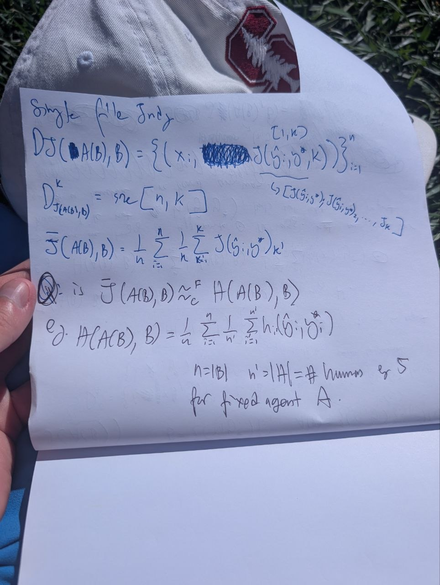
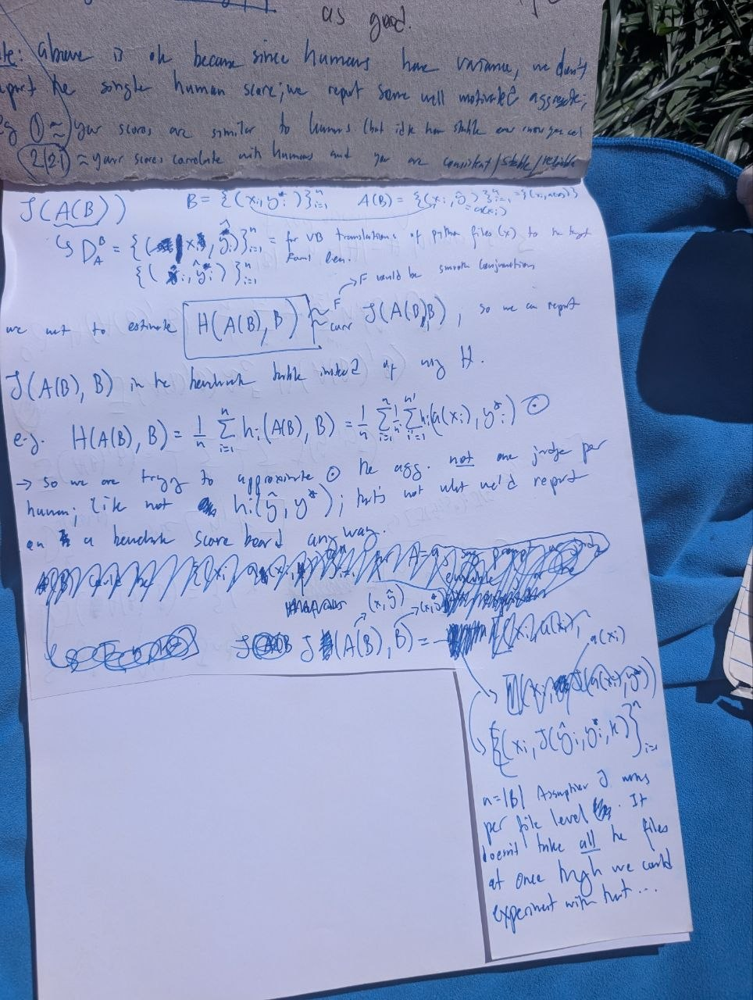
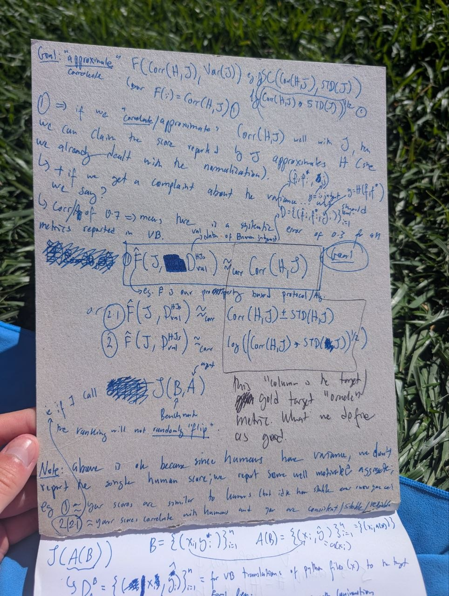

# Handwritten Judge Metric Transcription And Paper Notes
**TLDR:** These notes transcribe three handwritten photos about estimating a human benchmark score with an aggregate certified-judge score. The paper-facing takeaway is to report judge scores only through a validation layer: correlation with aggregate human ratings, repeated-call variance, and ranking-flip stability.

## Provenance

- Created on 2026-05-15 in `/Users/brandomiranda/cert-judge`.
- Source images were Telegram photos copied into `images/`.
- Four images were provided in the chat, but image 4 appears to duplicate image 3. This folder stores the three unique files.
- Existing experiment folders were checked. Related notes exist for no-gold-reference metrics, TVD-MI, human validation, and trust-index formulation, but no exact transcription of these photos was found.

## Image Index

| Local file | Chat image | Role |
|------------|------------|------|
| `images/image_1_single_file_judge_dataset.jpg` | Image 1 | Defines repeated judge calls over benchmark items and compares aggregate judge score to aggregate human score. |
| `images/image_2_benchmark_human_estimator.jpg` | Image 2 | Defines benchmark set `B`, agent outputs `A(B)`, and the benchmark-table score to estimate. |
| `images/image_3_corr_variance_target.jpg` | Image 3 and duplicate Image 4 | Sketches a meta-score based on judge-human correlation and judge variance/stability. |

## Transcription Conventions

- `[unclear]` means the handwriting is visible but not confidently readable.
- `[scribbled out]` means the image contains crossed-out text or formulas.
- Math is transcribed in LaTeX-like notation when possible.
- "Inferred meaning" is separated from "Visible transcription" so the artifact does not overclaim certainty.

## Image 1: Single-File Judge Dataset And Human Aggregate



### Visible Transcription

```text
single file only

D_J(A(B), B) = { (x_i, [scribbled out], J(\hat{y}_i, y_i^*, k)) }_{i=1}^n
                                                     (i, n)
                         [underbrace: E J(...), J_1, J_2, ..., J_k]

D^k_{J_{A(B),B}} = score [n, k]

\bar{J}(A(B), B)
  = (1/n) \sum_{i=1}^n (1/k) \sum_{k'=1}^k J(\hat{y}_i; y_i^*)_{k'}

Q: is \bar{J}(A(B), B) \approx_{\epsilon}^{R? C?} H(A(B), B)?

eg.
H(A(B), B)
  = (1/n) \sum_{i=1}^n (1/n') \sum_{i'=1}^{n'} h_{i'}(\hat{y}_i; y_i^*)

n = |B|
n' > |H| = # humans for [unclear]
for fixed agent A.
```

### Inferred Meaning

The photo defines the judge table for a fixed agent `A` on benchmark `B`. For each benchmark item `i`, the LLM judge is called `k` times on the candidate output `\hat{y}_i` and the gold/reference output `y_i^*`. The reportable judge score is the two-level mean:

```math
\bar{J}(A(B), B)
= \frac{1}{n}\sum_{i=1}^{n}\frac{1}{K}\sum_{r=1}^{K}
J_r(\hat{y}_i, y_i^*).
```

The target human score is similarly an aggregate over benchmark items and human raters:

```math
H(A(B), B)
= \frac{1}{n}\sum_{i=1}^{n}\frac{1}{M}\sum_{m=1}^{M}
h_m(\hat{y}_i, y_i^*).
```

The key research question is whether the aggregate judge score is a calibrated proxy for the aggregate human score, not whether one judge call matches one human rater.

## Image 2: Benchmark-Level Estimator



### Visible Transcription

```text
J(A(B))

B = { (x_i, y_i^*) }_{i=1}^n

A(B) = { (x_i, \hat{y}_i) }_{i=1}^n
     = { (x_i, a(x_i)) }_{i=1}^n          [last term partly unclear]

D_A^B = { ([scribbled out] | x_i, \hat{y}_i?) }_{i=1}^n
        { ([scribbled out], \hat{y}_i?) }_{i=1}^n
        = for VB translations of python files (x_i)
          to the target formal Lean.

[unclear] would be smooth conjunction

we want to estimate H(A(B), B) [boxed]
    [arrow/approx] \bar{J}(A(B), B),
so we can report \bar{J}(A(B), B)

J(A(B), B) in the benchmark table instead of avg H.

eg.
H(A(B), B)
  = (1/n) \sum_{i=1}^n h_i(A(B), B)
  = (1/n) \sum_{i=1}^n (1/n') \sum_{i'=1}^{n'} h_{i'}(x_i?, y_i^*)  [partly unclear]

-> so we are trying to approximate (1) the eqs. not one judge per
human; like not h_i(\hat{y}_i; y_i^*), but what we'd report
on a benchmark score board anyway.

[large scribbled-out section]

\bar{J}(A(B), \tilde{B}) = [scribbled out] ... a(x_i) ... u(x_i?) [unclear]

n = |B|. Assumes J runs per file level. It doesn't have all the files
at once but we could experiment with that...
```

### Inferred Meaning

The benchmark is a set of source/gold pairs:

```math
B = \{(x_i, y_i^*)\}_{i=1}^{n}.
```

An agent maps each source item to a candidate Lean artifact:

```math
A(B) = \{(x_i, \hat{y}_i)\}_{i=1}^{n}
     = \{(x_i, A(x_i))\}_{i=1}^{n}.
```

The benchmark table should report a scalable score for the whole agent:

```math
\bar{J}(A(B), B)
```

as a proxy for the unavailable or expensive human aggregate:

```math
H(A(B), B).
```

The note explicitly rejects the wrong target: the point is not to imitate one human rater on one file. The point is to estimate the same aggregate quantity a benchmark scoreboard would report if it could afford multiple expert humans per item.

## Image 3: Correlation, Variance, And Stability Target



### Visible Transcription

```text
Goal: "approximate" / correlate

F(Corr(H, J), Var(J))
e.g. SC(Corr(H, J), STD(J))

[possibly:] F(j) = Corr(H, J)      [marked/circled as option 1]

(1) => if we "correlate/approximate" Corr(H,J) with J
we can claim the score reported by J approximates H
(see we already dealt with the normalization)

b) + if we get a complaint about the variance, we'd say?

b) corr/proof 0.7 => mean has not a systematic error [unclear]
metrics reported in VB

\hat{F}(J, D_{val}^{HJS}) \approx_{corr} Corr(H_i, J)        [boxed]
                      [notes: HJS val, value of human & judge]

[text under box:] e.g. F is our properties based [unclear] algo

or
(2) \hat{F}(J, D_{val}^{HJS}) \approx_{corr} Corr(H_i, J) \pm STD(H_i, J)

(3) \hat{F}(J, D_{val}^{HJS}) \approx_{corr}
    log((Corr(H_i, J) * STD([unclear]))^{1/2})

[right box:]
Corr(H_i, J) \pm STD(H_i, J)
log((Corr(H_i, J) * STD([unclear]))^{1/2})

this "volume" is the target
could target "[unclear]" metric that we define as good.

i.e. if I call [scribbled] J(B,A)
Benchmark
the ranking will not randomly "flip".

Note: above is ok because since humans have variance, we don't
report the single human score; we report some well motivated aggregate.
e.g.
(1) ~= your scores are similar to humans (but idk how stable/var [unclear])
(2/2') ~= your scores correlate with humans and you are consistent/stable/reliable.
```

### Inferred Meaning

This photo sketches the meta-validation layer. The handwritten `F` is a function that predicts or summarizes judge trust from two ingredients:

```math
F(J) = f(\operatorname{Corr}(H,J), \operatorname{Var}(J)).
```

The first ingredient is external validity: the judge's scores correlate with aggregate human scores. The second ingredient is reliability: repeated calls should have low variance and should not randomly change leaderboard rankings.

The notes also suggest a validation dataset:

```math
D_{\mathrm{val}}^{HJS}
```

where `HJS` likely means a validation set containing human scores, judge scores, and source/candidate/gold artifacts. A meta-score `\hat{F}` estimated on this validation data could be evaluated by how well it predicts:

```math
\operatorname{Corr}(H,J)
```

or a composite of correlation and standard deviation.

The "volume" formula is too ambiguous to use directly. A safer paper version would define a lower-confidence trust score, such as:

```math
\operatorname{TrustLCB}(J)
= \hat{\rho}_{H,J} - c \cdot \operatorname{SE}(\hat{\rho}_{H,J})
  - \lambda \cdot \overline{\sigma}_J,
```

or a normalized reliability-weighted correlation:

```math
\operatorname{TrustScore}(J)
= \hat{\rho}_{H,J} \cdot (1 - \operatorname{FlipRate}(J)).
```

This is closer to the current repo's `CertIndex` and P4/P6 framing than the ambiguous log-volume sketch.

## Paper-Facing Notes

### Main Claim To Preserve

The core claim should be:

> We do not use a single LLM score as a human replacement. We validate an aggregate LLM-judge score as a proxy for the aggregate expert score that a benchmark would report if repeated human evaluation were affordable.

This framing avoids the fragile claim that one LLM call equals one human rater.

### Suggested Method Framing

For an agent `A` evaluated on benchmark `B = \{(x_i,y_i^*)\}_{i=1}^n`, define the judge score as the repeated-call benchmark mean:

```math
\bar{J}(A(B),B)
= \frac{1}{n}\sum_{i=1}^{n}\frac{1}{K}\sum_{r=1}^{K}
J_r(A(x_i),y_i^*).
```

Define the human target as the panel mean:

```math
H(A(B),B)
= \frac{1}{n}\sum_{i=1}^{n}\frac{1}{M}\sum_{m=1}^{M}
h_m(A(x_i),y_i^*).
```

Then validate the judge by reporting:

1. `Corr(H,J)`: does the aggregate judge score rank agents/items like humans?
2. `Var(J)` or repeated-call standard deviation: is the judge score stable?
3. `FlipRate(J)`: how often does the ranking of two agents/items reverse under judge resampling?
4. Property scores `P1`-`P7`: do falsifiable structure checks predict human alignment?

### Candidate Paper Paragraph

Automated judging is useful only if the reported number is validated against the same quantity a benchmark would otherwise obtain from expert raters. For an agent `A` on benchmark `B`, define the reportable judge score as a mean over tasks and repeated judge calls, not as a single LLM response. The validation target should be a panel-style human aggregate: the mean score over tasks and expert raters. This separates two questions that are often conflated: whether the judge is externally valid, measured by correlation with human aggregate scores, and whether it is reliable, measured by repeated-call variance and ranking-flip probability.

### Candidate Figure/Table Idea

Create a small validation panel with three axes:

| Panel | What it shows | Paper message |
|-------|---------------|---------------|
| A | Scatter of aggregate judge score vs aggregate human score | Tests whether the judge tracks the human target. |
| B | Distribution of repeated-call standard deviation by item | Tests whether the score is stable enough to report. |
| C | Pairwise ranking flip rate under resampling | Tests whether benchmark conclusions are robust to judge noise. |

### Relationship To Existing Repository Work

- `experiments/03_human_validation/` already supports the human-vs-judge correlation part.
- `experiments/06_cert_index_vs_human_judge_corr_and_low_var/` matches the idea that certification predicts human correlation and low variance.
- `experiments/06_/trust_index_formulation.md` already records the CertIndex shape: identity, bug monotonicity, weak monotonicity, flip stability, and anti-baseline terms.
- `experiments/07_property_vs_expected_behavior_corr/` connects property behavior to expected behavior.
- `experiments/04_mutual_evalutation/plan_mutual_evaluation_integration.md` is the natural extension for inter-rater reliability and rubric robustness.

### Claims Not Yet Safe For The Paper

- Do not claim that `\bar{J}` is an unbiased estimate of `H` unless this is shown on held-out human labels.
- Do not use the ambiguous handwritten log-volume formula directly.
- Do not claim correctness from correlation alone. A stable, high-correlation judge can still share systematic bias with humans or miss prover-relevant errors.
- Do not report a single-human target as the gold standard. The handwritten notes correctly point toward an aggregate human target because humans have variance.

## Next Experiment Sketch

1. Build `D_{\mathrm{val}}^{HJS}` from existing human-label rows and judge-score rows.
2. For each judge, compute `Corr(H,J)`, `SE(Corr(H,J))`, repeated-call standard deviation, and pairwise flip rate.
3. Fit or compare simple meta-scores:
   - `CertIndex`
   - `CertIndex * (1 - FlipRate)`
   - `Corr(H,J) - c * SE - lambda * mean_std`
4. Evaluate whether the meta-score predicts held-out human correlation across judges or prompts.
5. Use the resulting table to justify why the paper reports an aggregate certified judge score rather than raw LLM outputs.
