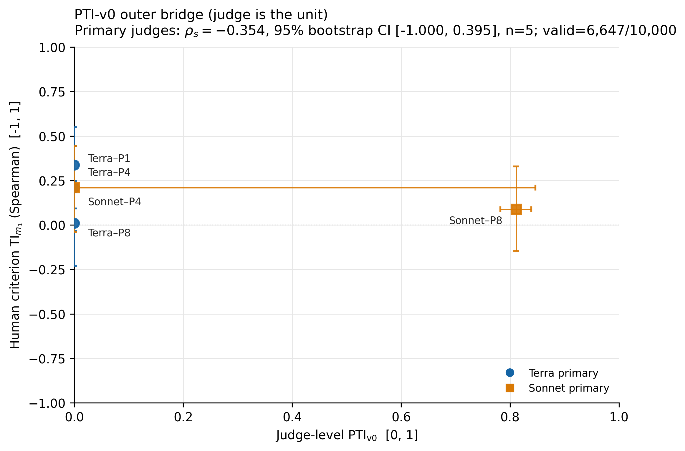

# Experiment 29 v5 results — 2026-08-26 03:40:50 PDT

**TLDR-start:** [cj: pti-v0] The subscription-CLI run completed all 774 tasks and 4,728 score cells. The preregistered primaries-only outer bridge is Spearman `-0.3536` (95% judge-bootstrap CI `[-1.0000, 0.3953]`, `n=5`, 6,647/10,000 valid replicates): below the `0.5` SESOI and inconclusive about zero. Four of five primary `PTI_v0` values are exact zeros; Sonnet + P8 is `0.8114`. No positive bridge or deployment claim is supported.

W&B Report: [Experiment 29 — PTI-v0 v5 outer bridge](https://wandb.ai/brando-su/cert-judge-pti-v0/reports/Experiment-29-%E2%80%94-PTI-v0-v5-outer-bridge--VmlldzoxNzgwOTk0Ng==)

## Frozen configuration and provenance

- Metric: `PTI_v0`; execution protocol: `PTI_v0_cli_v5`.
- Pre-result commit: `395efdc00584cad32f6e9a525a8dbd9b201ff2a7`.
- Mandatory pre-bridge commit:
  `6f55c44299eadda78db5738c7913475d06ea671f`.
- Config fingerprint:
  `735bd5951d4e6f8e9bf5f0d5e374028e1e46d92077b64584a7f89ff30981be9e`.
- Property-table SHA-256:
  `7a904f31a6dbd626a728e44fd7a00043c61b5e1630937986f111a0be4af15c0a`.
- Exact v4 model panel (`gpt-5.3-codex`, `gpt-4o-mini`): `NOT_RUN`.
- Actual v5 scoring IDs: `gpt-5.6-terra` and requested/scoring
  `claude-sonnet-5`.
- Claude CLI telemetry additionally reports auxiliary `claude-haiku-4-5` on
  all 258 Claude calls. The retained evidence does not justify a Sonnet-only
  claim or prove that the helper could not affect execution.
- Subscription auth: ChatGPT and first-party `claude.ai` Max.
- Provider API spend: `$0`.
- Execution limitation: deterministic artifact-disjoint batches prevent a
  typed artifact's related cells from sharing context, but unrelated cases do
  share a batch context.

## Completion

| Quantity | Result |
|---|---:|
| Accepted CLI tasks | 774 / 774 |
| Tasks per LLM configuration | 129 / 129 |
| Unique score cells | 4,728 / 4,728 |
| Score records | 14,184 |
| Nonlocal cells | 3,546 |
| Local-control cells | 1,182 |
| Invalid accepted / quarantined | 0 / 0 |
| Excluded failed attempts | 4, all retried successfully |
| Human criterion rows | 72 |
| Property/criterion coverage | 100% |

## Property results

| Judge | Role | P_eq | P_bm | P_ms | P_eqalpha | PTI_eq,bm,ms | PTI_v0 |
|---|---|---:|---:|---:|---:|---:|---:|
| Terra + P8 | primary | 0.0000 | 0.0000 | 0.0000 | 0.0000 | 0.0000 | 0.0000 |
| Terra + P4 | primary | 0.0000 | 0.0000 | 0.0000 | 0.8828 | 0.0000 | 0.0000 |
| Terra + P1 | primary | 0.0000 | 0.0000 | 0.0000 | 0.9387 | 0.0000 | 0.0000 |
| Sonnet + P8 | primary | 0.9187 | 0.6467 | 0.7791 | 0.9366 | 0.7735 | 0.8114 |
| Sonnet + P4 | primary | 0.0000 | 0.6651 | 0.8069 | 0.9036 | 0.0000 | 0.0000 |
| String control | control | 1.0000 | 0.0000 | 0.8456 | 0.9359 | 0.0000 | 0.0000 |
| Edit distance | control | 1.0000 | 0.0000 | 0.0000 | 0.9992 | 0.0000 | 0.0000 |
| Random | control | 0.4241 | 0.0000 | 0.0000 | 1.0000 | 0.0000 | 0.0000 |

Sonnet + P8 has a four-property 95% artifact-cluster bootstrap interval of
`[0.7820, 0.8391]`. Independent reconstruction verified that every exact-zero
aggregate contains an observed exact-zero artifact factor. Missingness was not
converted to zero.

## Human criterion

The primary human view is the arithmetic mean of strict and lenient labels,
with the median over three judge repeats before the item-level correlation.

| Judge | TI_m1 Spearman | 95% paired-cluster CI | Kendall tau-b |
|---|---:|---:|---:|
| Terra + P8 | 0.0105 | [-0.2294, 0.2475] | 0.0082 |
| Terra + P4 | 0.2106 | [-0.0338, 0.4425] | 0.1772 |
| Terra + P1 | 0.3377 | [0.0933, 0.5514] | 0.2861 |
| Sonnet + P8 | 0.0886 | [-0.1463, 0.3291] | 0.0685 |
| Sonnet + P4 | 0.2098 | [-0.0396, 0.4426] | 0.1656 |
| String control | 0.4255 | [0.2061, 0.6102] | 0.3337 |
| Edit distance | 0.1987 | [-0.0793, 0.4562] | 0.1484 |
| Random | -0.0008 | [-0.2351, 0.2254] | -0.0031 |

## Held-out outer bridge

| Analysis | Spearman | Kendall tau-b | 95% judge-bootstrap CI | Valid / 10,000 | n | Interpretation |
|---|---:|---:|---:|---:|---:|---|
| Primaries, PTI_v0 | -0.3536 | -0.3162 | [-1.0000, 0.3953] | 6,647 | 5 | Below SESOI; inconclusive about zero |
| Primaries, PTI_eq,bm,ms | -0.3536 | -0.3162 | [-1.0000, 0.3953] | 6,647 | 5 | Same tie pattern; same association |
| Primaries + controls | -0.2474 | -0.2143 | [-0.8165, 0.2568] | 6,521 | 8 | Secondary; below SESOI and inconclusive |

Family leave-one-out is not computable: removing Sonnet leaves three Terra
judges with constant PTI, and removing Terra leaves only two judges.

Exploratory primaries-only per-property Spearman estimates are `P_eq=-0.3536`,
`P_bm=-0.2236`, `P_ms=-0.2236`, and `P_eqalpha=0.6000`; every corresponding
95% interval includes zero (the latter three span `[-1,1]`). These are
exploratory diagnostics, not a basis for post-result metric selection.

## SESOI simulation

The frozen Gaussian-copula simulation uses the five empirical primary
criterion ranks, 10,000 draws per target correlation, and the complete positive
decision rule: point Spearman at least `0.5` and lower bootstrap bound above
zero. At true Spearman `0.5`:

- mean realized Spearman: `0.4747`;
- point-at-or-above-SESOI rate: `60.67%`;
- full positive-decision power: `27.10%`;
- empirical false-pass rate under the median screen: `25.83%`;
- empirical top-1 benefit retention: `45.31%`.

The panel is low-power for the frozen positive rule. The observed result is an
honest below-SESOI/inconclusive outcome, not evidence for a positive bridge.

## QA, tests, and outputs

- Fresh independent read-only numerical reconstruction: all score, property,
  criterion, bootstrap, and CSV/JSON checks passed; one major auxiliary-model
  provenance finding was retained. See `../../RESULTS_QA.md`.
- Builder conformance suite: `79 passed` across PTI core/pipeline/CLI, structural
  probe, and Exp27 plotting tests.
- Figure QA: both PNGs inspected at original resolution; exact coordinates and
  two-axis uncertainty are shown; no `y=x`, no PTI/TI level MAE, and no paired
  density claim.
- Python byte-compilation passed. Ruff was unavailable in the active uv
  environment and is recorded as such rather than reported as passing.

Authoritative artifacts:

- `../../results/properties/properties.json`
- `../../results/criterion/criterion.json`
- `../../results/bridge/bridge_pti_v0.json`
- `../../results/bridge/bridge_eq_bm_ms.json`
- `../../results/sesoi/sesoi_simulation.json`
- `../../results/figures/outer_bridge_source_data.csv`
- `../../results/figures/outer_bridge_primaries.pdf`
- `../../results/wandb_report.json`

Primary figure:



## Exact reproduction commands

```bash
python experiments/29_pti_v0_cli_bridge/run_pti_v0_cli.py status
python experiments/04_veribench_validation/run_pti_v0.py compute-bridge \
  --properties experiments/29_pti_v0_cli_bridge/results/properties/properties.json \
  --criterion experiments/29_pti_v0_cli_bridge/results/criterion/criterion.json \
  --variant PTI_v0 \
  --prebridge-commit 6f55c44299eadda78db5738c7913475d06ea671f \
  --bootstrap-iters 10000 --seed 0 \
  --out experiments/29_pti_v0_cli_bridge/results/bridge/bridge_pti_v0.json \
  --no-api
python experiments/04_veribench_validation/run_pti_v0.py simulate-sesoi \
  --criterion experiments/29_pti_v0_cli_bridge/results/criterion/criterion.json \
  --rhos 0.1 0.2 0.3 0.4 0.5 0.6 0.7 0.8 0.9 \
  --draws 10000 --seed 0 --sesoi 0.5 --decision-bootstrap-iters 10000 \
  --out experiments/29_pti_v0_cli_bridge/results/sesoi/sesoi_simulation.json \
  --no-api
MPLBACKEND=Agg python experiments/29_pti_v0_cli_bridge/generate_bridge_figure.py
```

**TLDR-end:** [cj: pti-v0] Experiment 29 v5 is complete and reproducible. It does not support the preregistered positive outer bridge: the estimate is negative, the interval is wide, and the five-judge design has only 27.1% power at the SESOI.
