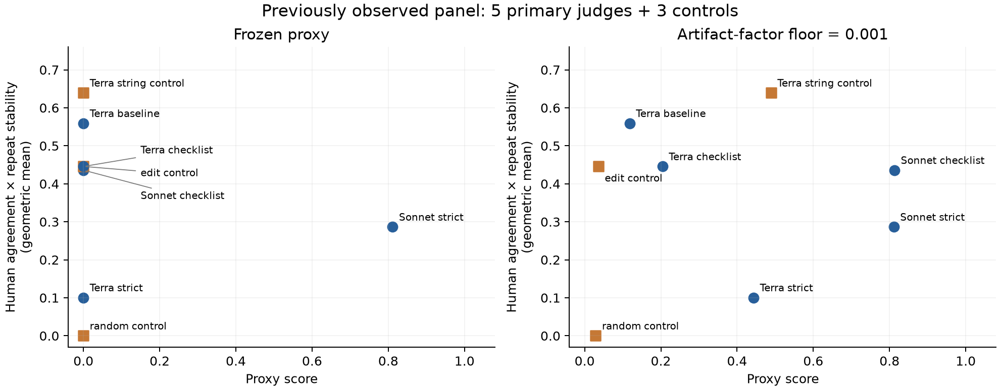
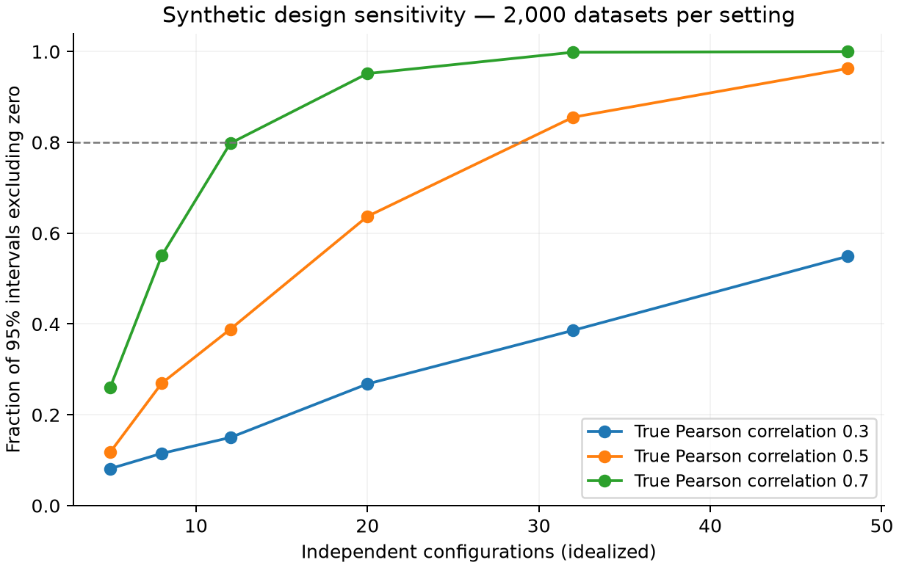

# Proxy validation follow-up experiments

**TLDR:** Adding repeat stability does not establish proxy validity on the current panel: the frozen index’s Spearman association is −0.354 across the five primary judges, and the 0.001-floor alternative is −0.600. The comparisons are exploratory, their problem-bootstrap intervals cross zero, and two primary judge families cannot support the requested train/validation/test design.

**Generated:** 2026-09-10T23:07:40-07:00
**Status:** Experiments completed; independent review recorded in the experiment-root results.md.

## What was executed

The run reconstructs both saved proxy variants, recomputes the combined target from 1,728 criterion-associated scores, compares all declared aggregation variants, resamples shared problems, tests family-held-out calibration, and simulates sampling designs. It performs zero model calls and collects zero new human labels.

| Setting | Value |
|---|---|
| Human-labeled candidates / problems | 72 / 24 |
| Primary configurations / model families | 5 / 2 |
| Controls | 3, reported separately |
| Repeats per candidate and judge | 3 |
| Problem-bootstrap draws / seed | 2000 / 20260911 |
| Synthetic datasets per design | 2,000 |
| Judge-score scale / human scale | [0,1] / [0,5], human scores divided by 5 once |
| Primary variability convention | Mean within-candidate sample standard deviation, denominator K−1 |

## Combined human-grounded target

Trust Index 2-prime is the square root of nonnegative human agreement times one minus repeat variability. The signed agreement is retained, including when its contribution is clamped to zero. Pearson, Spearman, Kendall tau-b and absolute-agreement intraclass correlation are separate target definitions; their shared observations do not provide independent confirmations.

| Judge | Role | Human Spearman | Repeat standard deviation | Combined trust |
|---|---|---:|---:|---:|
| claude-sonnet-5 / P4_CHECKLIST | primary | 0.210 | 0.094 | 0.436 |
| claude-sonnet-5 / P8_STRICT_B | primary | 0.089 | 0.074 | 0.286 |
| editdist_e1 | control | 0.199 | 0.000 | 0.446 |
| gpt-5.6-terra / BAD_STRINGY | control | 0.425 | 0.039 | 0.639 |
| gpt-5.6-terra / P1_BASELINE | primary | 0.338 | 0.074 | 0.559 |
| gpt-5.6-terra / P4_CHECKLIST | primary | 0.211 | 0.057 | 0.446 |
| gpt-5.6-terra / P8_STRICT_B | primary | 0.011 | 0.039 | 0.101 |
| random_r1 | control | -0.001 | 0.000 | 0.000 |

The seeded random control repeats identically by construction; perfect repeatability does not make its answers accurate. The string-similarity control has the highest combined target on this panel, so control intent and the human criterion disagree. This does not independently prove either criterion correct.

## Proxy comparisons

These rows use the averaged rubric and Spearman-based combined target. The full machine-readable comparison includes all three rubric views, four target definitions, and Pearson, Spearman, Kendall, Lin concordance, and intraclass-correlation diagnostics between proxy and target.

| Panel | Proxy | Pearson | Spearman | Kendall | 95% problem-bootstrap interval for Spearman |
|---|---|---:|---:|---:|---|
| primary | frozen | -0.250 | -0.354 | -0.316 | [-0.707, 0.709]; 1997/2000 defined |
| primary | floor_0.001 | -0.368 | -0.600 | -0.400 | [-0.975, 0.600]; 1997/2000 defined |
| primary | mean_then_gm | -0.620 | -0.600 | -0.400 | [-0.900, 0.600]; 1997/2000 defined |
| primary | stability_only | -0.641 | -0.500 | -0.400 | [-1.000, 0.300]; 1997/2000 defined |
| all | frozen | -0.142 | -0.247 | -0.214 | [-0.577, 0.483]; 2000/2000 defined |
| all | floor_0.001 | 0.091 | 0.071 | 0.071 | [-0.500, 0.609]; 2000/2000 defined |
| all | mean_then_gm | 0.201 | -0.190 | -0.071 | [-0.563, 0.527]; 2000/2000 defined |
| all | stability_only | -0.388 | -0.108 | -0.109 | [-0.731, 0.275]; 2000/2000 defined |



The floor improves ranking resolution, but it does not establish the intended ranking among primary judges. These exposed data cannot select a replacement and then validate it. The stability-only comparator also tests whether a shared repeatability term creates the apparent relationship.

## What causes the zeros

7/8 aggregate proxy scores are zero. Bug monotonicity is zero for 6/8, correcting pull request 42’s 7/8 statement. Equality can independently collapse the aggregate; a zero raw score on a degraded ladder rung is not itself the zero rule. The rule acts on artifact-level property factors and their geometric aggregates.

The committed zero audit includes every property’s factor-zero counts and a leave-one-problem-out aggregation check. Factors, strict and floored aggregates reproduce the frozen data within 1e-12 before new analyses run.

## Generalization and calibration

Only two primary judge-model families are available. Controls are excluded from the family-transfer analysis; generation slots are not documented generator-model families. A whole-family train/validation/test split is therefore not computable here.

| Proxy | Prediction method | Mean squared error on held-out families | Spearman |
|---|---|---:|---:|
| frozen | raw | 0.197382 | -0.354 |
| frozen | training_mean | 0.025108 | -0.289 |
| frozen | nonnegative | 0.025108 | -0.289 |
| frozen | unrestricted | 0.027807 | 0.289 |
| floor_0.001 | raw | 0.157623 | -0.600 |
| floor_0.001 | training_mean | 0.025108 | -0.289 |
| floor_0.001 | nonnegative | 1738.281056 | -0.667 |
| floor_0.001 | unrestricted | 1738.525744 | -0.700 |

The nearly equal Sonnet proxy scores produce a steep calibration from only two training points; extrapolating to Terra gives extreme predictions and large errors. This is a recorded failure of the prespecified linear calibration, not missing data or a numerical exception. No clipping or replacement calibration was selected after seeing the result. Full fold slopes and predictions are saved. A reversing calibration tests a different claim from a positively oriented raw proxy; the training-mean baseline remains visible.

## Sample-size experiment

These are synthetic bivariate-normal scenarios, not a fitted forecast of unseen models or a measured human-label reliability. At true Pearson correlation 0.5, the independent-unit simulations give:

| Independent units | Zero-exclusion frequency | Mean interval width | 95% interval coverage |
|---:|---:|---:|---:|
| 5 | 11.8% | 1.452 | 96.0% |
| 8 | 27.0% | 1.094 | 95.5% |
| 12 | 38.9% | 0.891 | 95.3% |
| 20 | 63.7% | 0.678 | 94.5% |
| 32 | 85.5% | 0.529 | 95.3% |
| 48 | 96.2% | 0.429 | 94.7% |



Twelve or twenty configurations are not a universal sufficiency rule. Related prompts further reduce effective independence: the separate clustered scenarios show that treating them as independent can under-cover the population correlation. Their specified intrafamily correlation of 0.7 is an assumption, not an estimate from two families.

## Uncertainty and interpretation

The problem bootstrap jointly resamples problems for every judge and recomputes proxy and criterion with the same weights. It preserves candidates within a problem and complete observed repeat vectors. Its intervals condition on the observed human labels, model calls and configurations; they do not measure uncertainty over new raters, future calls or new model families. Undefined correlations are counted. Pairwise ranking fractions are bootstrap frequencies, not posterior probabilities.

The new analysis does not use the earlier automatic ceiling correction or independent-pair intervals for fitted cross-validation predictions. The same-person cross-rubric Spearman value 0.249 is not an intraclass-correlation estimate for the revised five-rater pool. Judge-level criterion reliability must be established at that level rather than borrowed from individual labels.

## Reproduce and inspect

```bash
PYTHONPATH=py_src .venv/bin/python experiments/30_proxy_trust_index_held_out_validity/expt_v2/run_diagnostics.py
.venv/bin/python experiments/30_proxy_trust_index_held_out_validity/expt_v2/render_report.py
```

The run manifest records source hashes, the seed, software versions and exact judge identifiers. No experiment-29 files were overwritten. All grids were specified in PROTOCOL.md before this follow-up run, after the historical data had already been inspected.

Weights & Biases report: [open published report](https://wandb.ai/brando-su/cert-judge-pti-v0/reports/Experiment-30-—-Combined-trust-and-zero-handling-diagnostics--VmlldzoxNzkxMjU0OA==).

Method references: [intraclass-correlation definitions](https://pmc.ncbi.nlm.nih.gov/articles/PMC4913118/), [cross-validation dependence](https://www.jmlr.org/papers/v5/grandvalet04a.html), [small-sample rank inference](https://docs.scipy.org/doc/scipy/reference/generated/scipy.stats.spearmanr.html).

**TLDR-end:** The combined target and zero-handling experiments do not establish proxy validity; retain the alternatives as exploratory and expand independent families only under a new locked design.
