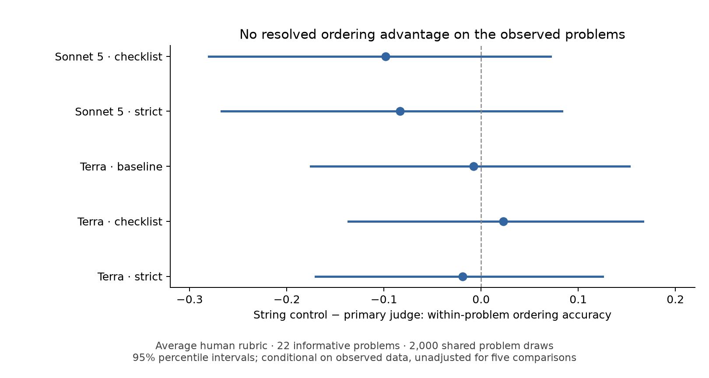

# Within-problem criterion audit

**TLDR:** This audit separates pooled agreement from ordering among answers to the same problem; it does not change the human labels or validate a replacement proxy. The prespecified average-rubric decision is INCONCLUSIVE.

## Executed

Used 72 already exposed candidates from 24 problems, eight judges and three cached repeats. All original joins and proxy reconstructions passed before this new analysis. No new model calls, human annotations or benchmark reference edits occurred.

| Judge | Pooled Spearman | Within-problem centered Pearson | Within-problem pair accuracy |
|---|---:|---:|---:|
| claude-sonnet-5 / P4_CHECKLIST | 0.210 | 0.184 | 0.576 |
| claude-sonnet-5 / P8_STRICT_B | 0.089 | 0.079 | 0.561 |
| editdist_e1 | 0.199 | -0.213 | 0.288 |
| gpt-5.6-terra / BAD_STRINGY | 0.425 | 0.070 | 0.477 |
| gpt-5.6-terra / P1_BASELINE | 0.338 | 0.349 | 0.485 |
| gpt-5.6-terra / P4_CHECKLIST | 0.211 | 0.161 | 0.455 |
| gpt-5.6-terra / P8_STRICT_B | 0.011 | 0.168 | 0.496 |
| random_r1 | -0.001 | -0.089 | 0.356 |

The three columns measure different quantities. Centered Pearson removes each problem's mean from both scores; it is not partial Spearman. Pair accuracy uses human-unequal pairs, gives a judge tie one-half credit, and weights informative problems equally.

| Primary judge | String control minus primary pair accuracy | Conditional 95% interval |
|---|---:|---|
| claude-sonnet-5 / P4_CHECKLIST | -0.098 | [-0.280, 0.071] |
| claude-sonnet-5 / P8_STRICT_B | -0.083 | [-0.267, 0.083] |
| gpt-5.6-terra / P1_BASELINE | -0.008 | [-0.175, 0.153] |
| gpt-5.6-terra / P4_CHECKLIST | 0.023 | [-0.136, 0.167] |
| gpt-5.6-terra / P8_STRICT_B | -0.019 | [-0.170, 0.125] |

Average rubric: 22/24 informative problems, 52 human-unequal pairs and 20 human-tied pairs.

Intervals use 2,000 shared problem draws (seed 20260913). They are exploratory, unadjusted for multiple comparisons, and conditional on the observed labels, calls and configurations. They do not establish causality, label validity or generalization to future models. The strict and lenient rubric results remain separately available in audit.json.



## Prepared pilot inventory

Six problems and 18 candidates were selected by a fixed hash order, independently of labels and outcomes. pilot_inventory.json preserves every selected original request, judge identity and payload hash. All selected repeat scores are cached.

The selected inventory contains 144 criterion requests, 8 equality requests and 16 alpha-renaming requests; it contains no bug or missing-specification requests. Only one selected candidate has equality/renaming probes. It is therefore not ready for joint four-property proxy validation. The missing structural-probe coverage must be addressed under a separate protocol; the locked six-problem selection is unchanged.

A new model-family panel is not selected, quoted or launched. Its request identities, client/effort, output directory, budget and review must be frozen separately. This inventory is preparation for that runner, not a fresh-model evaluation.

## Reproduce

```bash
CUDA_VISIBLE_DEVICES='' PYTHONPATH=py_src python experiments/30_proxy_trust_index_held_out_validity/expt_v3/run_audit.py
CUDA_VISIBLE_DEVICES='' python experiments/30_proxy_trust_index_held_out_validity/expt_v3/render_plot.py
```

## Publication and acceptance

Generated: 2026-09-13 12:08 PDT.

[Weights & Biases report](https://wandb.ai/brando-su/cert-judge-pti-v0/reports/Experiment-30-v3-—-Within-problem-criterion-audit--VmlldzoxNzkyNTMxNQ==) · [completed run](https://wandb.ai/brando-su/cert-judge-pti-v0/runs/cj30v3b4f940eda85cac32).

The saved report was read back and its text matched the local report; the run state is finished. Source commit: `e26925b0ec6706484b13e0c8fc1209a5cfacdbba`. [Independent review and fixes](../QA.md): strongest Codex gpt-6-astra ultra, PASS with two minor fixes verified by 90 tests; the numerical result is unchanged. This is the single strongest fallback after Claude Fable 5.1/max returned a usage error; no cross-company review is claimed.

**TLDR-end:** Use the within-problem diagnostic to choose the next audit; keep the new-family claim pending and preserve all earlier frozen results.
