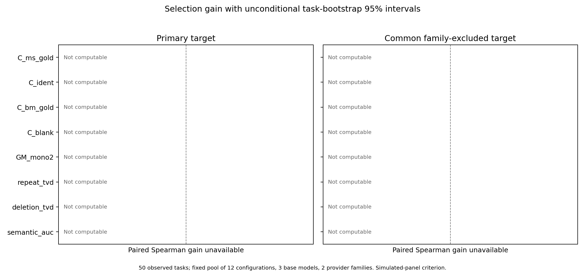

# Full simulated-panel judge-screening campaign

**Doc link:** [Frozen protocol and additive amendments](README.md)
**TLDR:** The complete frozen screen yields 2 DROP_CONSTANT, 5 DROP_UNCOMPUTABLE, 1 INCONCLUSIVE. These simulated-panel results establish no judge–human validation or deployment guarantee.

Complete 12-configuration criterion support is Primary persona target: 0/691; Instructions-only target: 0/691; Common Anthropic/Alibaba-excluded target: 0/691. The frozen protocol requires 90% common item coverage. Where that gate fails, pooled association and selection estimates and their 95% intervals remain undefined; the tables retain finite/10,000 task-bootstrap draw counts (seed 47; p-val=n/a). No configuration was removed to improve common support. Exclusion from this sandbox shortlist is not evidence that a property is scientifically inferior. Any two-Opus sensitivity conditions on those cached configurations and cannot establish complete-pool selection utility.

## Recommendations

| Property | Frozen screening-rule result | Primary gain over H2 [95% interval] | Common-family-excluded gain over H2 [95% interval] |
|---|---|---|---|
| C_ms_gold | DROP_UNCOMPUTABLE | undefined [undefined]; 0/10000 finite | undefined [undefined]; 0/10000 finite |
| C_ident | DROP_CONSTANT | undefined [undefined]; 0/10000 finite | undefined [undefined]; 0/10000 finite |
| C_bm_gold | INCONCLUSIVE | undefined [undefined]; 0/10000 finite | undefined [undefined]; 0/10000 finite |
| C_blank | DROP_CONSTANT | undefined [undefined]; 0/10000 finite | undefined [undefined]; 0/10000 finite |
| GM_mono2 | DROP_UNCOMPUTABLE | undefined [undefined]; 0/10000 finite | undefined [undefined]; 0/10000 finite |
| repeat_tvd | DROP_UNCOMPUTABLE | undefined [undefined]; 0/10000 finite | undefined [undefined]; 0/10000 finite |
| deletion_tvd | DROP_UNCOMPUTABLE | undefined [undefined]; 0/10000 finite | undefined [undefined]; 0/10000 finite |
| semantic_auc | DROP_UNCOMPUTABLE | undefined [undefined]; 0/10000 finite | undefined [undefined]; 0/10000 finite |

No property satisfies the strong follow-up rule. Positive point estimates without positive lower bounds remain inconclusive; absence of evidence is not equivalence.
The fixed rule requires at least 11 of 12 computable property configurations, nonconstant values, positive association and positive paired H2 gain in both required targets. Strong follow-up additionally requires both gain interval lower bounds above zero. Constants, uncomputable properties, or a nonpositive gain upper bound in either required target are dropped from this sandbox shortlist. The threshold is an agent-chosen screen, not a universal validated standard.

## Population, evidence and missingness

The frozen universe contains 750 candidates over 50 tasks: 691 source-declared nonblank and 59 blank. The 650 original-group target rows reproduce saved targets to six decimals. The 100 late rows have no saved target file; their evidence is the frozen aggregation tests and rating provenance. All six authorized source recovery streams are included. Historical fold-specific learned judges remain separate evaluation procedures; ensembles remain distinct from members.

| Probe kind | Declared structural rows | Verified valid | Invalid/unverified |
|---|---:|---:|---:|
| blank | 50 | 50 | 0 |
| bm_gold | 200 | 66 | 134 |
| crit | 750 | 750 | 0 |
| ident | 50 | 49 | 1 |
| ms_cand | 1474 | 1050 | 424 |
| ms_gold | 198 | 177 | 21 |

Unique compilation receipts: 2641; successful: 1711; failed or unverified: 930. These counts concern unique source hashes, not independent tasks. Evidence: [compile_summary.json](expt_v1/probes/compile_summary.json).

| Compiler receipt class | Count |
|---|---:|
| elaboration | 421 |
| ok | 1711 |
| parse | 110 |
| timeout | 3 |
| type_or_elaboration | 392 |
| unresolved_import | 4 |

Criterion rows remain declared even when the candidate fails Lean compilation. Structural validity is determined independently of judge outcomes. Complete invalidity and compiler diagnostics are retained in [probe_manifest.json](expt_v1/probes/probe_manifest.json).
Per-judge coverage and all nine criterion metrics, including original/late and explicit blank-zero sensitivities, appear in [the criterion report](RESULTS_criterion_campaign.md). Full common-support counts, component coverage, selectors, tied weights, paired regret and gains, and conditional/unconditional intervals are in [RESULTS_full_analysis_details.md](RESULTS_full_analysis_details.md) and their linked machine-readable sources.

## What the properties and uncertainty mean

The geometric-mean monotonicity property GM_mono2 combines reference deletion and candidate deletion, as Amendment02 and the exact frozen owner function specify. Historical reference-deletion quality uses its original first repeat; the second-repeat supplement serves only the owner deletion information property. The repeat total-variation-distance property requires at least two candidates with all three accepted repeats within a task, rather than requiring every candidate. Bin-label permutations preserve its value.

semantic_auc is NOT_COMPUTABLE: none of the50 fresh reference hashes matches the25 owner historical audited source hashes. The exact frozen source-manifest hash matches the owner input inventory; [semantic_audit_availability.json](expt_v1/results/semantic_audit_availability.json) records the availability check. Ordinary compile-valid deletion does not establish strict weakening or formatting equivalence, and no substitute semantic evidence was invented.

Three base-model clusters are Opus, Qwen and Sonnet. Qwen single-call and Terminus2 variants share one cluster; the four harness/model identities and 12 configurations are not independent models. Only two provider families are observed, so population association inference is fragile. Provider/base exclusions are sensitivities, and single-family results do not establish transfer to unseen families.

Group-transfer selection excludes held-out candidate contributions, including reconstruction of the repeat-information joint distribution. It conditions on shared known references and is not task transfer. Five task folds instead select using four task folds and evaluate the fifth. Equal-group results weight each of the 15 groups equally and retain paired task uncertainty.

The common target excludes Anthropic and Alibaba for comparable cross-judge quality. Own-family targets use different criteria and are sensitivity results only. The intervals condition on existing simulated ratings and omit new human-rater and model-family uncertainty. Reusing task information, exploratory protocol development and known historical failures limit confirmatory interpretation. Compilation establishes elaboration, not semantic weakening or bug relevance. A compiler timeout means nonverification within the frozen time bound, not proof of Lean invalidity; timeout diagnostics remain separately classified.

## Costs, infrastructure and provenance

Final offline re-verification accepts 18759/19432 original probe task occurrences from all twelve runs; 38912 collected files and 2241835678 bytes were rehashed. The complete sanitized acceptance, failure, server-state, cost and collection bindings are in [original_artifact_reconciliation.json](expt_v1/results/probes/original_artifact_reconciliation.json). No transport command is permitted during this check.

criterion: reported total USD undefined; known reported sum USD 673.0186; 11823 cells with unknown charges. Evidence: [charges.json](expt_v1/results/criterion/charges.json).
probes: reported total USD undefined; known reported sum USD 1428.7918; 38 cells with unknown charges. Evidence: [charges.json](expt_v1/results/probes/charges.json).

Additive [Amendment05](AMENDMENT_05_released_run_capacity.md) reused task slots released by named terminal probe runs. It preserved the original run identifiers, complete task masks and scientific settings, with at most one update for each of four named targets and provider totals bounded by their original admission totals (100 Anthropic, 140 Alibaba task slots). These are operational task-slot limits, not request-rate guarantees. Original admission concurrency20 remains historical evidence. The dedicated update responses acknowledge the values below; independent live concurrency metadata was unavailable. No run, task or inference retry was added. [capacity_provenance.json](expt_v1/results/probes/capacity_provenance.json) binds the frozen condition and every actual scheduling receipt.

| Configuration | Scheduling outcome | Server-acknowledged task concurrency |
|---|---|---:|
| opus55x / H0 | ACKNOWLEDGED | 50 |
| opus55x / H2 | ACKNOWLEDGED | 50 |
| t2_qwen / D0 | ACKNOWLEDGED | 70 |
| t2_qwen / H2 | ACKNOWLEDGED | 70 |

All measured inference used Vals-funded Valkyrie with frozen named model selectors, prompts, parsers and harnesses. Provider backend revision identity was not established. Failed transport/admission conditions and original run identifiers remain preserved. Collection recovery reads original artifacts and does not repeat measured verdicts. Missing charges are unavailable, never interpreted as zero. The adapter status unmeasured_infra also covers parser or uncertified-submission outcomes for agent rows; counted acceptance reasons distinguish these from explicitly observed transport failures. Unreported Hypertext Transfer Protocol (HTTP) statuses and retry histories remain unavailable; an episode finish reason or a requested task completion does not establish successful verdict submission or absence of an earlier infrastructure failure. Original hashed archives preserve the available response metadata. No provider keys or purchased subscription credits were used.

Cached and structural controls: [existing procedure report](RESULTS_existing_and_controls.md). Conditional power planning, all transfers and all unfavorable/undefined results: [RESULTS_full_analysis_details.md](RESULTS_full_analysis_details.md). Raw provider-private outputs remain in ignored owned storage; published evidence is sanitized.

